# Extracción de claims médicos en español

Este repositorio contiene el experimento local para extraer y normalizar un
claim central, verificable y autocontenido desde noticias médicas en español de
Latinoamérica. No clasifica una noticia como verdadera o falsa y todavía no
recupera ni ordena evidencia.

La primera entrega compara únicamente cuatro modelos generativos: dos
preentrenados en español y dos multilingües aplicados a español. La traducción,
generación de consultas, ranking de artículos, baselines extractivos, ablations
de entrada y revisión humana son fases posteriores y quedan fuera de esta rama.

## Contexto rápido para colaboradores

> **Estado del experimento:** este README describe el protocolo ejecutable de
> Seminario 1. No afirma que ya existan 300 claims Gold, modelos entrenados ni
> métricas finales: esos resultados solo existirán cuando se complete la
> anotación, se congele el manifiesto y se ejecute el experimento.

El aporte metodológico de esta fase es una comparación controlada de cuatro
modelos encoder-decoder locales para transformar una noticia médica en español
en **un único claim central, declarativo, verificable y autocontenido**. No se
evalúa si el claim es verdadero o falso; tampoco se evalúa recuperación de
evidencia científica. La unidad de análisis es una noticia y el objetivo de
aprendizaje es su claim de referencia humano.

### Decisiones que no se deben cambiar durante Sem1

| Decisión | Regla de Sem1 | Motivo |
| --- | --- | --- |
| Unidad de salida | Un claim central por noticia | Mantiene un objetivo seq2seq manejable y comparable entre los cuatro modelos. |
| Entrada de modelo | `source_text = title + body` | Los cuatro modelos reciben exactamente el mismo texto. La bajada solo ayuda a anotar. |
| Gold | `reference_claim` escrito en Label Studio | Es el target de entrenamiento y la referencia para las métricas. No se usa texto generado por modelos como Gold. |
| Span | Fragmento literal que respalda el claim | Sirve para trazabilidad de la anotación; no entra al modelo ni es el target. |
| Modelos | T5S, BARTO, mBART-50 y uMT5-Base | Única comparación de modelos de esta entrega. |
| Métricas | METEOR, ROUGE-L F1 y exact match normalizado | METEOR es la métrica principal; las otras dos son complementarias. |
| Separación | 240 train / 30 validation / 30 test | Se fija antes de entrenar y no se modifica después de observar resultados. |

### Por qué hay 700 tareas, pero el Gold tiene 300 noticias

Las 700 tareas de Label Studio son un **pool de cribado**, no 700 ejemplos de
entrenamiento. Algunas noticias no tendrán un claim médico central adecuado,
podrán ser ruido editorial o podrán compartir el mismo texto fuente. Después
de anotar, solo pueden entrar al Gold las tareas que cumplan simultáneamente:

1. Estén marcadas como aptas con claim (`APTA_CON_CLAIM`).
2. Tengan un `reference_claim` no vacío.
3. Tengan título o cuerpo disponible.
4. No dupliquen el `source_text` de otra noticia seleccionada.

`build_sem1_manifest.py` selecciona 300 tareas aptas y únicas con una semilla
fija, asigna `train`, `validation` y `test`, y escribe el manifiesto. El
archivo no se sobrescribe: cuando existe, queda congelado para evitar elegir el
test en función de los resultados. Si el export no contiene al menos 300 tareas
aptas y no duplicadas, el comando falla; no rellena casos ni inventa claims.

### Pipeline de datos de Sem1

```mermaid
flowchart LR
    A["Noticias médicas en español<br/>Inventario: title, subtitle y body"]
    B["Filtrar cuerpos disponibles<br/>y ≥ 400 caracteres"]
    C["700 tareas candidatas<br/>en Label Studio"]
    D["Anotar una noticia<br/>claim central + span + elegibilidad"]
    E["Exportar JSON<br/>y construir reference_claims.csv<br/>300 pares noticia → claim"]
    F["Congelar split<br/>240 train · 30 validation · 30 test"]
    G["Fine-tuning supervisado<br/>T5S · BARTO · mBART-50 · uMT5"]
    H["Predecir sobre los 30 casos test"]
    I["Comparar predicción vs. Gold<br/>METEOR · ROUGE-L F1 · Exact match"]

    A --> B --> C --> D --> E --> F --> G --> H --> I
```



Los datos que debe producir cada etapa son:

| Artefacto | Contenido esencial | Uso |
| --- | --- | --- |
| Export JSON de Label Studio | Tarea, selección de elegibilidad, span y `reference_claim` | Fuente local de la anotación; no se versiona en Git. |
| `manifest_final_300.csv` | `record_id`, `split`, `sample_role`, `source_hash`, país y fecha | Lista cerrada de las 300 noticias y de sus splits. |
| `reference_claims.csv` | Identidad, metadatos, `title`, `body`, `source_text`, `reference_claim`, elegibilidad y split | Gold completo usado por entrenamiento, inferencia y evaluación. |
| `train.csv`, `validation.csv`, `test.csv` | Filas Gold separadas según el manifiesto | Entrenamiento, selección de checkpoint y evaluación final. |
| `predictions/<modelo>.jsonl` | Un claim generado por cada caso test | Entrada de la evaluación. |
| `evaluation/<modelo>/summary.csv` | METEOR, ROUGE-L F1, exact match y diagnósticos | Tabla comparativa del notebook. |

La anotación no es un ejercicio de copiar el span. Primero se selecciona el
fragmento que sustenta la afirmación; después se escribe `reference_claim` como
una oración autónoma y fiel a ese fragmento. El modelo verá `title + body` y
aprenderá a producir el claim; el span permite comprobar de dónde salió ese
target cuando haya dudas.

### Límites explícitos de la primera entrega

No se deben describir como resultados de Sem1: extracción multiclaim,
traducción a inglés, generación de queries, consulta o ranking de PubMed,
veredicto de veracidad, baselines extractivos, ablations de entrada o revisión
humana ciega. Esas extensiones son candidatas para una investigación posterior,
no partes incompletas del experimento actual.

## Modelos incluidos

| Id | Modelo base local | Papel metodológico | Referencia |
| --- | --- | --- | --- |
| t5s_spanish | vgaraujov/t5-base-spanish | T5 preentrenado en español | Spanish Pre-trained Language Models; AKCIT-FN 2025 |
| barto_spanish | vgaraujov/bart-base-spanish | BART preentrenado en español | Spanish Pre-trained Language Models |
| mbart50_es | facebook/mbart-large-50 | Seq2seq multilingüe con entrada y salida `es_XX` | AKCIT-FN at CheckThat! 2025 |
| umt5_base_es | google/umt5-base | Normalización multilingüe con configuración española | MMA at CheckThat! 2025 |

Los cuatro se ejecutan localmente con PyTorch y Transformers. mBART-50 se
configura explícitamente con `src_lang=es_XX`, `tgt_lang=es_XX` y el token
forzado de inicio de generación en español. No se usa una API
de generación ni LM Studio. LM Studio no aporta una ventaja para estos modelos
encoder-decoder y no reproduce el flujo de fine-tuning de los artículos.

T5S y BARTO son checkpoints encoder-decoder preentrenados en español. mBART-50
y uMT5-Base son checkpoints multilingües; en ambos casos el entrenamiento y la
generación de esta rama se orientan explícitamente a español.

## Diseño experimental de esta fase

Seminario 1 es un experimento supervisado de **un claim central por noticia**.
No descompone una noticia en múltiples claims y no realiza recuperación PubMed,
generación de consultas ni veredictos de verdad. Cada ejemplo es un par
`noticia en español → claim central, declarativo, verificable y autocontenido`.
La entrada efectiva de los cuatro modelos es `source_text = título + cuerpo`;
la bajada se conserva para la anotación, pero no forma parte de la entrada del
modelo en esta fase.

La decisión de hacer fine-tuning no es un detalle de implementación. El paper
de Drive **#49** usa fine-tuning de encoder-decoder SLMs para los idiomas que
tienen train/dev/test, incluido español; reserva el zero-shot para LLMs con
prompting y lenguas sin datos. Los papers **#80** y **#81** también formulan
la normalización como generación seq2seq supervisada. Por ello T5S, BARTO,
mBART-50 y uMT5 se ajustan localmente con el Gold manual; no se presentan como
extractores zero-shot. La única comparación de Sem1 consiste en los resultados
de esos cuatro modelos bajo el mismo Gold y los mismos splits.

El CSV recibido contiene noticias y cuerpos, pero no claims de referencia. Por
eso la primera fase tiene un requisito explícito: anotar un subconjunto con un
claim central antes de entrenar o calcular métricas de referencia. Las 700
tareas de Label Studio son un pool de candidatos: el manifiesto final define
las 300 que forman el Gold y deja las no seleccionadas fuera del experimento.
No se inventan etiquetas ni se usan borradores generados por modelos como Gold.

Con reference_claim anotado, se reportan exactamente tres métricas: METEOR,
ROUGE-L F1 y exact match normalizado. Sin referencia solo se reportan
diagnósticos operativos (salidas vacías, claims muy cortos, longitud y
duplicados); no se presentan como calidad del modelo. Esta separación reproduce
la lógica evaluable de los trabajos de CheckThat! y evita calcular métricas sin
ground truth.

## Preparación local

En un Mac con Apple Silicon el código detecta MPS automáticamente. La
configuración conserva los hiperparámetros de cada artículo como punto de
partida y ajusta batch/gradient accumulation al límite de memoria local.

    make setup
    make test
    make download-models

Los pesos se guardan en la caché local de Hugging Face, no dentro del
repositorio. La descarga incluye pesos base, no checkpoints finetuneados
inexistentes o no publicados. No se conserva una integración de sincronización
ni automatización con Label Studio: solo se importa localmente su export JSON
manual para construir el Gold. La rama queda deliberadamente limitada al
entrenamiento, inferencia y evaluación local de los cuatro modelos; traducción,
generación de consultas, PubMed y ranking son fases posteriores fuera de este
checkout.

## Flujo de Seminario 1

Cuando termine la anotación en Label Studio, descarga **Export → JSON**. No
uses el CSV crudo de Label Studio para entrenar. Construye un manifiesto final
con exactamente 300 `record_id` y la columna `split`:

```text
240 train | 30 validation | 30 test
```

El primer comando selecciona con semilla fija 300 tareas aptas, con claim
completo y texto fuente no duplicado. Las tareas restantes quedan como reserva.
No ejecutes el comando de nuevo: el manifiesto se congela para que no se pueda
escoger el test después de observar resultados. Luego ejecuta:

    make build-gold-manifest \
      LABEL_STUDIO_EXPORT=/ruta/export_label_studio.json \
      MANIFEST=/ruta/manifest_final_300.csv
    make import-labelstudio-gold \
      LABEL_STUDIO_EXPORT=/ruta/export_label_studio.json \
      MANIFEST=/ruta/manifest_final_300.csv
    make split-gold

El segundo comando solo incorpora al Gold los `record_id` del manifiesto y falla
si falta un claim apto. El tercero verifica exactamente 240/30/30 y escribe
`artifacts/gold/train.csv`, `validation.csv` y `test.csv`.

Entrena cada modelo con train, selecciona el checkpoint por validation e
infiere únicamente sobre test:

    make train MODEL=t5s_spanish TRAIN=artifacts/gold/train.csv VALIDATION=artifacts/gold/validation.csv OUT=artifacts/checkpoints/t5s_spanish
    make train MODEL=barto_spanish TRAIN=artifacts/gold/train.csv VALIDATION=artifacts/gold/validation.csv OUT=artifacts/checkpoints/barto_spanish
    make train MODEL=mbart50_es TRAIN=artifacts/gold/train.csv VALIDATION=artifacts/gold/validation.csv OUT=artifacts/checkpoints/mbart50_es
    make train MODEL=umt5_base_es TRAIN=artifacts/gold/train.csv VALIDATION=artifacts/gold/validation.csv OUT=artifacts/checkpoints/umt5_base_es

    make infer MODEL=t5s_spanish CHECKPOINT=artifacts/checkpoints/t5s_spanish/best INPUT=artifacts/gold/test.csv OUT=artifacts/predictions/t5s_spanish.jsonl
    make evaluate PREDICTIONS=artifacts/predictions/t5s_spanish.jsonl REFERENCES=artifacts/gold/test.csv OUT=artifacts/evaluation/t5s_spanish

Repite inferencia y evaluación para los cuatro modelos. Abre
`notebooks/02_resultados_modelos.ipynb` para que se genere la tabla comparativa
de métricas y diagnósticos. La métrica principal es METEOR; ROUGE-L F1 y exact
match normalizado son complementarias.

## Flujo histórico de preparación local

Primero prepara candidatos desde el CSV entregado. El archivo original no se
copia ni se versiona.

    make prepare-corpus INPUT=/ruta/noticias_mednews_titulos_bodies_20261028.csv OUT=artifacts/candidates.jsonl

Para construir el conjunto de referencia:

    make reference-template INPUT=artifacts/candidates.jsonl OUT=artifacts/references_to_annotate.csv SAMPLE_SIZE=100

Completa reference_claim manualmente y divide esa tabla en train/validation
antes de entrenar. El script falla si quedan claims vacíos.

    make split-reference INPUT=artifacts/references_to_annotate.csv TRAIN=artifacts/train.csv VALIDATION=artifacts/validation.csv VALIDATION_FRACTION=0.2
    make train MODEL=t5s_spanish TRAIN=/ruta/train.csv VALIDATION=/ruta/validation.csv OUT=artifacts/checkpoints/t5s_spanish
    make train MODEL=barto_spanish TRAIN=/ruta/train.csv VALIDATION=/ruta/validation.csv OUT=artifacts/checkpoints/barto_spanish
    make train MODEL=mbart50_es TRAIN=/ruta/train.csv VALIDATION=/ruta/validation.csv OUT=artifacts/checkpoints/mbart50_es
    make train MODEL=umt5_base_es TRAIN=/ruta/train.csv VALIDATION=/ruta/validation.csv OUT=artifacts/checkpoints/umt5_base_es
    make infer MODEL=t5s_spanish CHECKPOINT=artifacts/checkpoints/t5s_spanish/best INPUT=artifacts/candidates.jsonl OUT=artifacts/predictions/t5s_spanish.jsonl
    make evaluate PREDICTIONS=artifacts/predictions/t5s_spanish.jsonl REFERENCES=/ruta/validation.csv OUT=artifacts/evaluation/t5s_spanish

La guía metodológica detallada está en docs/EXPERIMENT_PROTOCOL.md.

