# Extracción de claims médicos en español

Este repositorio contiene el experimento local para extraer y normalizar un
claim central, verificable y autocontenido desde noticias médicas en español de
Latinoamérica. No clasifica una noticia como verdadera o falsa y todavía no
recupera ni ordena evidencia.

La primera entrega compara únicamente cuatro modelos generativos: dos
preentrenados en español y dos multilingües aplicados a español. La traducción,
generación de consultas, ranking de artículos, baselines extractivos, ablations
de entrada y revisión humana son fases posteriores y quedan fuera de esta rama.

## Contexto rápido para colaboradores

> **Estado del experimento:** este README describe el protocolo ejecutable de
> Seminario 1. El conjunto de referencia anotado y los checkpoints se mantienen locales e
> ignorados por Git. No se deben inferir métricas finales desde este documento:
> solo existen después de una corrida registrada de los cuatro modelos.

El aporte metodológico de esta fase es una comparación controlada de cuatro
modelos encoder-decoder locales para transformar una noticia médica en español
en **un único claim central, declarativo, verificable y autocontenido**. No se
evalúa si el claim es verdadero o falso; tampoco se evalúa recuperación de
evidencia científica. La unidad de análisis es una noticia y el objetivo de
aprendizaje es su claim de referencia humano.

Antes de construir el conjunto de referencia anotado, el corpus se recolecta desde **NewsData API** con
noticias médicas en español. `fetch-newsdata` conserva el inventario inicial
de noticias (URL, título y fecha); después `extract-news-body` descarga el HTML
de cada URL y extrae el cuerpo con **BeautifulSoup**. Solo las noticias con
`body` disponible y al menos 400 caracteres pasan al pool candidato de
Label Studio. Esta fase prepara el corpus; no es una etapa de recuperación ni
verificación científica.

### Decisiones que no se deben cambiar durante Sem1

| Decisión | Regla de Sem1 | Motivo |
| --- | --- | --- |
| Unidad de salida | Un claim central por noticia | Mantiene un objetivo seq2seq manejable y comparable entre los cuatro modelos. |
| Entrada de modelo | `source_text = title + body` | Los cuatro modelos reciben exactamente el mismo texto. La bajada solo ayuda a anotar. |
| Conjunto de referencia anotado | `reference_claim` escrito en Label Studio | Es el target de entrenamiento y la referencia para las métricas. No se usa texto generado por modelos como referencia. |
| Anotación en Label Studio | Elegibilidad + `reference_claim` | La elegibilidad decide si la noticia entra al conjunto de referencia; `reference_claim` es el target. No se anotan spans en Sem1. |
| Modelos | T5S, BARTO, mBART-50 y uMT5-Base | Única comparación de modelos de esta entrega. |
| Métricas | METEOR, ROUGE-L F1 y BERTScore F1 | METEOR es la métrica principal; ROUGE-L aporta solapamiento y BERTScore similitud semántica. |
| Separación | 320 train / 40 validation / 40 test | Se fija antes de entrenar y no se modifica después de observar resultados. |

### Por qué hay 700 tareas, pero el conjunto de referencia tiene 400 noticias

Las 700 tareas de Label Studio son un **pool de cribado**, no 700 ejemplos de
entrenamiento. Algunas noticias no tendrán un claim médico central adecuado,
podrán ser ruido editorial o podrán compartir el mismo texto fuente. Después
de anotar, solo pueden entrar al conjunto de referencia las tareas que cumplan simultáneamente:

1. Estén marcadas como aptas con claim (`APTA_CON_CLAIM`).
2. Tengan un `reference_claim` no vacío.
3. Tengan título o cuerpo disponible.
4. No dupliquen el `source_text` ni el `reference_claim` normalizado de otra
   noticia seleccionada.
5. Contengan un claim central de 5 a 80 palabras; los fragmentos más cortos o
   más largos se marcan como URL, respuesta incompleta o pegado accidental del
   artículo completo.

Antes de congelar esa selección, `audit_labelstudio_export.py` escribe una
tabla de las 700 tareas y otra con pares exactos o similares para revisión. Los
pares similares no se excluyen automáticamente porque pueden ser noticias
distintas; los duplicados exactos de fuente o claim sí se excluyen al construir
el manifiesto. `build_sem1_manifest.py` selecciona 400 tareas aptas y únicas
con una semilla fija, asigna `train`, `validation` y `test`, y escribe el
manifiesto. El archivo no se sobrescribe: cuando existe, queda congelado para
evitar elegir el test en función de los resultados. Si el export no contiene al
menos 400 tareas aptas y no duplicadas, el comando falla; no rellena casos ni
inventa claims.

### Pipeline de datos de Sem1

```mermaid
flowchart LR
    A["NewsData API<br/>noticias médicas en español"]
    B["Inventario de noticias<br/>URL · título · fecha"]
    C["Extraer body HTML<br/>BeautifulSoup"]
    D["Filtrar cuerpos disponibles<br/>body ≥ 400 caracteres"]
    E["700 tareas candidatas<br/>en Label Studio"]
    F["Anotar una noticia<br/>claim central + elegibilidad"]
    G["Exportar JSON y auditar<br/>700 tareas + duplicados a revisar"]
    H["Construir reference_claims.csv<br/>400 pares noticia → claim"]
    I["Congelar split<br/>320 train · 40 validation · 40 test"]
    J["Fine-tuning supervisado<br/>T5S · BARTO · mBART-50 · uMT5"]
    K["Predecir sobre los 40 casos test"]
    L["Comparar predicción vs. referencia<br/>METEOR · ROUGE-L F1 · BERTScore F1"]

    A --> B --> C --> D --> E --> F --> G --> H --> I --> J --> K --> L
```



Los datos que debe producir cada etapa son:

| Artefacto | Contenido esencial | Uso |
| --- | --- | --- |
| Inventario de noticias | URL, título, fuente y fecha de NewsData API | Punto de partida trazable para recuperar los cuerpos de noticia. |
| Cuerpos extraídos | HTML procesado con BeautifulSoup, `body` y estado de extracción | Filtrar noticias con cuerpo utilizable antes de Label Studio. |
| Export JSON de Label Studio | Tarea, selección de elegibilidad y `reference_claim` | Fuente local de la anotación; no se versiona en Git. |
| `labelstudio_claims_audit.csv` | Las 700 tareas, estado, `reference_claim`, hashes y banderas de calidad | Revisión del cribado y de duplicados; no entra al entrenamiento. |
| `labelstudio_duplicate_review.csv` | Pares de fuentes o claims exactos/similares y acción sugerida | Revisión manual de similitudes antes de congelar el manifiesto. |
| `manifest_final_400.csv` | `record_id`, `split`, `sample_role`, `source_hash`, `claim_hash`, país y fecha | Lista cerrada de las 400 noticias y de sus splits. |
| `reference_claims.csv` | Identidad, metadatos, `title`, `body`, `source_text`, `reference_claim`, elegibilidad y split | Conjunto de referencia completo usado por entrenamiento, inferencia y evaluación. |
| `train.csv`, `validation.csv`, `test.csv` | Filas de referencia separadas según el manifiesto | Entrenamiento, selección de checkpoint y evaluación final. |
| `predictions/<modelo>.jsonl` | Un claim generado por cada caso test | Entrada de la evaluación. |
| `evaluation/<modelo>/summary.csv` | METEOR, ROUGE-L P/R/F1, BERTScore P/R/F1 y diagnósticos | Tabla comparativa y desglose complementario del notebook. |

La anotación consiste en decidir la elegibilidad de la noticia y escribir
`reference_claim` como una única oración autónoma, fiel al contenido y
verificable. El modelo verá `title + body` y aprenderá a producir ese claim.
Sem1 no registra spans ni usa fragmentos seleccionados como entrada o target.

### Límites explícitos de la primera entrega

No se deben describir como resultados de Sem1: extracción multiclaim,
traducción a inglés, generación de queries, consulta o ranking de PubMed,
veredicto de veracidad, baselines extractivos, ablations de entrada o revisión
humana ciega. Esas extensiones son candidatas para una investigación posterior,
no partes incompletas del experimento actual.

## Modelos incluidos

| Id | Modelo base local | Papel metodológico | Referencia |
| --- | --- | --- | --- |
| t5s_spanish | vgaraujov/t5-base-spanish | T5 preentrenado en español | Spanish Pre-trained Language Models; AKCIT-FN 2025 |
| barto_spanish | vgaraujov/bart-base-spanish | BART preentrenado en español | Spanish Pre-trained Language Models |
| mbart50_es | facebook/mbart-large-50 | Seq2seq multilingüe con entrada y salida `es_XX` | AKCIT-FN at CheckThat! 2025 |
| umt5_base_es | google/umt5-base | Normalización multilingüe con configuración española | MMA at CheckThat! 2025 |

Los cuatro se ejecutan localmente con PyTorch y Transformers. mBART-50 se
configura explícitamente con `src_lang=es_XX`, `tgt_lang=es_XX` y el token
forzado de inicio de generación en español. No se usa una API
de generación ni LM Studio. LM Studio no aporta una ventaja para estos modelos
encoder-decoder y no reproduce el flujo de fine-tuning de los artículos.

T5S y BARTO son checkpoints encoder-decoder preentrenados en español. mBART-50
y uMT5-Base son checkpoints multilingües; en ambos casos el entrenamiento y la
generación de esta rama se orientan explícitamente a español.

## Diseño experimental de esta fase

Seminario 1 es un experimento supervisado de **un claim central por noticia**.
No descompone una noticia en múltiples claims y no realiza recuperación PubMed,
generación de consultas ni veredictos de verdad. Cada ejemplo es un par
`noticia en español → claim central, declarativo, verificable y autocontenido`.
La entrada efectiva de los cuatro modelos es `source_text = título + cuerpo`;
la bajada se conserva para la anotación, pero no forma parte de la entrada del
modelo en esta fase.

La decisión de hacer fine-tuning no es un detalle de implementación. El paper
de Drive **#49** usa fine-tuning de encoder-decoder SLMs para los idiomas que
tienen train/dev/test, incluido español; reserva el zero-shot para LLMs con
prompting y lenguas sin datos. Los papers **#80** y **#81** también formulan
la normalización como generación seq2seq supervisada. Por ello T5S, BARTO,
mBART-50 y uMT5 se ajustan localmente con las referencias manuales; no se presentan como
extractores zero-shot. La única comparación de Sem1 consiste en los resultados
de esos cuatro modelos bajo el mismo conjunto de referencia y los mismos splits.

El CSV recibido contiene noticias y cuerpos, pero no claims de referencia. Por
eso la primera fase tiene un requisito explícito: anotar un subconjunto con un
claim central antes de entrenar o calcular métricas de referencia. Las 700
tareas de Label Studio son un pool de candidatos: el manifiesto final define
las 400 que forman el conjunto de referencia y deja las no seleccionadas fuera del experimento.
No se inventan etiquetas ni se usan borradores generados por modelos como referencias.

Con `reference_claim` anotado, la tabla principal reporta exactamente tres métricas:
METEOR, ROUGE-L F1 y BERTScore F1. Además, el resultado exporta el desglose
complementario de precision, recall y F1 para ROUGE-L y BERTScore; estas son
métricas de coincidencia de texto, no precision/recall de clasificación. Sin referencia solo se reportan
diagnósticos operativos (salidas vacías, claims muy cortos, longitud y
duplicados); no se presentan como calidad del modelo. Esta separación reproduce
la lógica evaluable de los trabajos de CheckThat! y evita calcular métricas sin
ground truth. BERTScore F1 usa `xlm-roberta-base` multilingüe, con español y
sin reescalado de baseline, para medir similitud semántica ante paráfrasis.

## Preparación local

En un Mac con Apple Silicon el código detecta MPS automáticamente. La
configuración conserva los hiperparámetros de cada artículo como punto de
partida y ajusta batch/gradient accumulation al límite de memoria local.

    make setup
    make test
    make download-models

Los pesos se guardan en la caché local de Hugging Face, no dentro del
repositorio. La descarga incluye pesos base, no checkpoints finetuneados
inexistentes o no publicados. No se conserva una integración de sincronización
ni automatización con Label Studio: solo se importa localmente su export JSON
manual para construir el conjunto de referencia. La rama queda deliberadamente limitada al
entrenamiento, inferencia y evaluación local de los cuatro modelos; traducción,
generación de consultas, PubMed y ranking son fases posteriores fuera de este
checkout.

### Recolectar noticias y cuerpos localmente

Los scripts locales reproducen la fase previa al conjunto de referencia. La clave de NewsData no
se escribe en archivos ni se versiona: expórtala solo en la sesión actual.

```bash
export NEWSDATA_API_KEY='tu_clave_local'
make fetch-news COUNTRIES=pe,ec,co
make extract-bodies
make prepare-corpus INPUT=artifacts/collection/newsdata_bodies.csv \
  OUT=artifacts/collection/candidates.jsonl
```

`fetch_newsdata.py` guarda el inventario de noticias con URL, título, fecha y fuente.
`extract_news_bodies.py` descarga cada URL y usa **BeautifulSoup** para extraer
el body HTML. Conserva estados como `OK`, `CUERPO_INSUFICIENTE`, `HTTP_ERROR`
o `URL_ERROR`; por tanto, no inventa ni descarta silenciosamente filas fallidas.
`prepare_claim_corpus.py` conserva después solo cuerpos `OK` de al menos 400
caracteres. Los CSV y JSONL generados quedan bajo `artifacts/`, ignorados por
Git.

## Flujo de Seminario 1

Cuando termine la anotación en Label Studio, descarga **Export → JSON**. No
uses el CSV crudo de Label Studio para entrenar. Primero audita las 700 tareas:

Si prefieres ejecutar el flujo guiado, abre
`notebooks/01_construir_referencias_sem1.ipynb`. El notebook ejecuta exactamente los
scripts descritos aquí y valida que termine en 400 filas con splits 320/40/40.

    make audit-labelstudio \
      LABEL_STUDIO_EXPORT=/ruta/export_label_studio.json

Este comando deja tres archivos locales e ignorados por Git:
`artifacts/audit/labelstudio_claims_audit.csv`,
`artifacts/audit/labelstudio_duplicate_review.csv` y
`artifacts/audit/labelstudio_audit_summary.json`. Revisa los pares marcados
como `near_claim` y `near_source`; son banderas, no descartes automáticos. Si
decides excluir alguno, guarda sus `record_id` en un CSV local con columna
`record_id` y pásalo como `EXCLUDE_RECORD_IDS` al siguiente comando. Después
construye un manifiesto final con exactamente 400 `record_id` y la columna
`split`:

```text
320 train | 40 validation | 40 test
```

El primer comando selecciona con semilla fija 400 tareas aptas, con claim
completo y sin duplicados exactos de fuente o claim. Las tareas restantes
quedan como reserva. No ejecutes el comando de nuevo: el manifiesto se congela
para que no se pueda escoger el test después de observar resultados. Luego
ejecuta:

    make build-reference-manifest \
      LABEL_STUDIO_EXPORT=/ruta/export_label_studio.json \
      MANIFEST=/ruta/manifest_final_400.csv \
      EXCLUDE_RECORD_IDS=/ruta/exclusiones_revisadas.csv
    make import-reference-set \
      LABEL_STUDIO_EXPORT=/ruta/export_label_studio.json \
      MANIFEST=/ruta/manifest_final_400.csv
    make split-reference-set

El segundo comando solo incorpora al conjunto de referencia los `record_id` del manifiesto y falla
si falta un claim apto. El tercero verifica exactamente 320/40/40 y escribe los
CSV dentro de `artifacts/sem1_20261031/final/`.

### Entrenar y medir la corrida de 400 claims

Abre `notebooks/02_entrenar_modelos_sem1.ipynb` o ejecuta una sola orden:

    make run-sem1

El orquestador entrena cada modelo con los 320 casos train, selecciona el mejor
checkpoint con los 40 casos validation, predice únicamente los 40 casos test y
calcula METEOR, ROUGE-L P/R/F1 y BERTScore P/R/F1 contra esos mismos 40 claims de referencia.
Los artefactos locales se separan por corrida:

```text
artifacts/runs/sem1_20261031_400_claims_v1/
├── logs/                 # salida completa de train, inferencia y evaluación
├── models/<modelo>/best/ # checkpoint seleccionado por validation
├── predictions/          # 40 claims generados por modelo
├── evaluation/<modelo>/  # summary.csv y per_prediction.csv
├── evaluation/summary.csv
└── run_status.json        # estado, errores, dispositivo y metadatos
```

Si un modelo ya terminó dentro de esa misma corrida, `make resume-sem1` lo
omite y conserva su resultado. Si una corrida queda incompleta, usa un nombre
de `RUN_DIR` nuevo para reintentar sin mezclar artefactos parciales.

Después abre `notebooks/02_resultados_modelos.ipynb`, ajusta `RUN_ID` si usaste
otro nombre y ejecútalo. El notebook solo lee el resumen de esa corrida y
genera las tablas comparativas bajo `evaluation/tables/`. METEOR es la métrica
principal; ROUGE-L F1 y BERTScore F1 son complementarias.

## Flujo histórico de preparación local

Primero prepara candidatos desde el CSV entregado. El archivo original no se
copia ni se versiona.

    make prepare-corpus INPUT=/ruta/noticias_mednews_titulos_bodies_20261028.csv OUT=artifacts/candidates.jsonl

Para construir el conjunto de referencia:

    make reference-template INPUT=artifacts/candidates.jsonl OUT=artifacts/references_to_annotate.csv SAMPLE_SIZE=100

Completa reference_claim manualmente y divide esa tabla en train/validation
antes de entrenar. El script falla si quedan claims vacíos.

    make split-reference INPUT=artifacts/references_to_annotate.csv TRAIN=artifacts/train.csv VALIDATION=artifacts/validation.csv VALIDATION_FRACTION=0.2
    make train MODEL=t5s_spanish TRAIN=/ruta/train.csv VALIDATION=/ruta/validation.csv OUT=artifacts/checkpoints/t5s_spanish
    make train MODEL=barto_spanish TRAIN=/ruta/train.csv VALIDATION=/ruta/validation.csv OUT=artifacts/checkpoints/barto_spanish
    make train MODEL=mbart50_es TRAIN=/ruta/train.csv VALIDATION=/ruta/validation.csv OUT=artifacts/checkpoints/mbart50_es
    make train MODEL=umt5_base_es TRAIN=/ruta/train.csv VALIDATION=/ruta/validation.csv OUT=artifacts/checkpoints/umt5_base_es
    make infer MODEL=t5s_spanish CHECKPOINT=artifacts/checkpoints/t5s_spanish/best INPUT=artifacts/candidates.jsonl OUT=artifacts/predictions/t5s_spanish.jsonl
    make evaluate PREDICTIONS=artifacts/predictions/t5s_spanish.jsonl REFERENCES=/ruta/validation.csv OUT=artifacts/evaluation/t5s_spanish

La guía metodológica detallada está en docs/EXPERIMENT_PROTOCOL.md.

