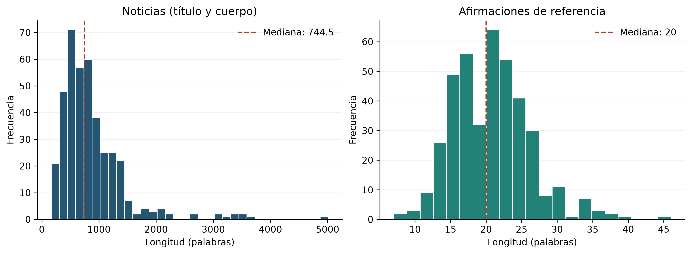
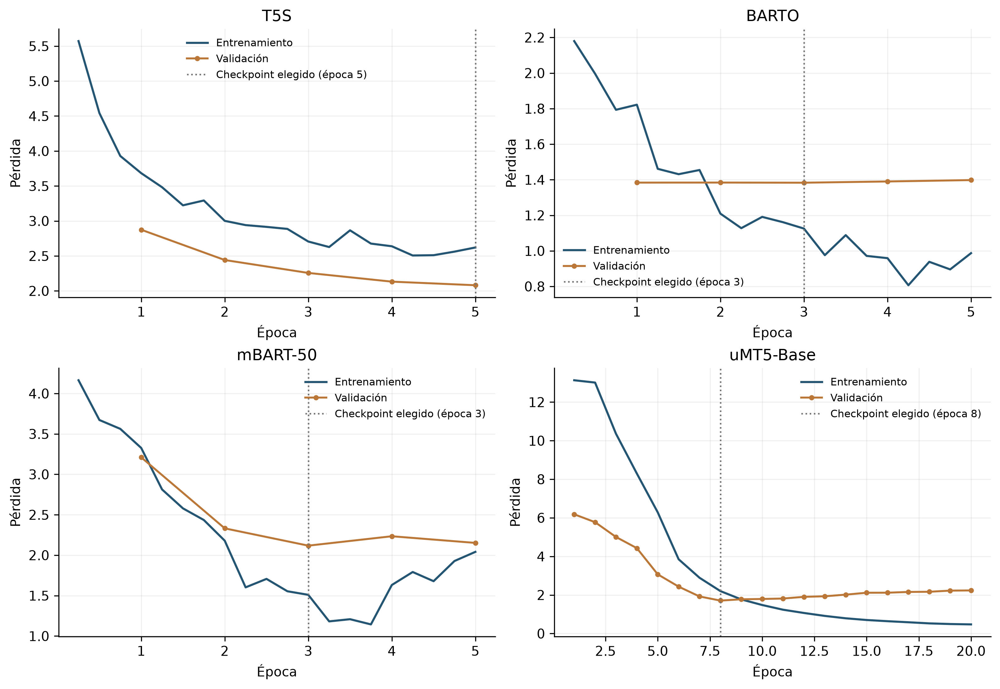
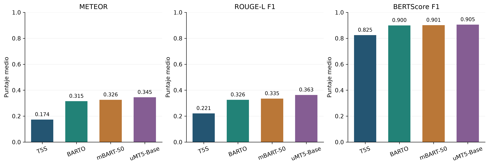
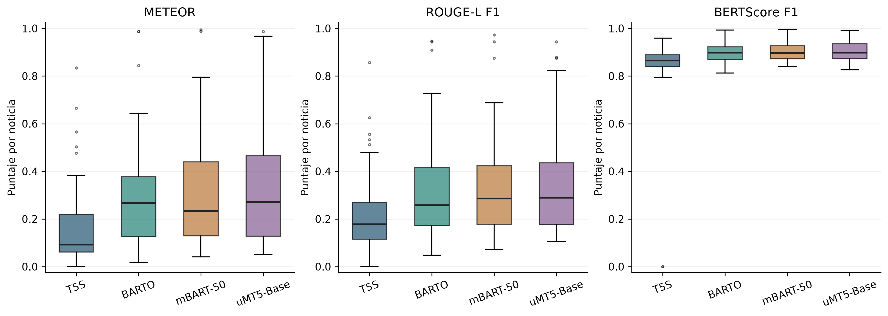

# Resultados Sem1 preliminares — configuración no controlada

> Esta corrida histórica no debe usarse para comparar arquitecturas ni para
> afirmar que uMT5-Base es superior: uMT5 se ejecutó con 20 épocas y un
> presupuesto de optimización y decodificación distinto de los otros modelos.
> Se conserva solo por trazabilidad. La comparación válida se publica en la
> corrida controlada de cinco épocas para los cuatro modelos.

Corrida: `sem1_20261031_400_claims_v1`. Resultados locales existentes de T5S, BARTO, mBART-50 y uMT5-Base.

El corpus anotado contiene 400 noticias latinoamericanas en español: 320 de entrenamiento, 40 de validación y 40 de prueba. Cada modelo se evaluó sobre las mismas 40 noticias de prueba. Estas tablas y figuras son artefactos históricos de esa corrida; el flujo operativo vigente de evaluación está en [el notebook 04](../../../notebooks/04_evaluar_y_visualizar_modelos.ipynb).

## Métricas principales

Media de los puntajes por noticia, en escala de 0 a 1. METEOR es la métrica principal; ROUGE-L F1 y BERTScore F1 son complementarias.

| Modelo | Noticias de prueba | METEOR | ROUGE-L F1 | BERTScore F1 |
| --- | ---: | ---: | ---: | ---: |
| T5S | 40 | 0.1735 | 0.2209 | 0.8246 |
| BARTO | 40 | 0.3150 | 0.3258 | 0.8997 |
| mBART-50 | 40 | 0.3258 | 0.3351 | 0.9012 |
| uMT5-Base | 40 | 0.3451 | 0.3635 | 0.9055 |

## Tablas exportadas

Los CSV conservan los valores numéricos exportados; los HTML facilitan la visualización.
- Distribucion particiones: [CSV](tables/01_distribucion_particiones.csv) · [HTML](tables/01_distribucion_particiones.html).
- Longitudes palabras: [CSV](tables/02_longitudes_palabras.csv) · [HTML](tables/02_longitudes_palabras.html).
- Distribucion pais territorio: [CSV](tables/03_distribucion_pais_territorio.csv) · [HTML](tables/03_distribucion_pais_territorio.html).
- Checkpoints seleccionados: [CSV](tables/04_checkpoints_seleccionados.csv) · [HTML](tables/04_checkpoints_seleccionados.html).
- Metricas principales: [CSV](tables/05_metricas_principales.csv) · [HTML](tables/05_metricas_principales.html).
- Desglose precision recall f1: [CSV](tables/06_desglose_precision_recall_f1.csv) · [HTML](tables/06_desglose_precision_recall_f1.html).
- Diagnosticos generacion: [CSV](tables/07_diagnosticos_generacion.csv) · [HTML](tables/07_diagnosticos_generacion.html).

## Figuras

Los PNG están exportados a 300 dpi; los PDF conservan los elementos vectoriales. La numeración de estos archivos es interna y no fija la numeración del artículo.

### Longitudes del corpus en palabras

[Descargar PNG](figures/01_histogramas_longitud_palabras.png) · [Descargar PDF](figures/01_histogramas_longitud_palabras.pdf)

### Pérdidas de entrenamiento y validación

[Descargar PNG](figures/02_curvas_perdida_entrenamiento_validacion.png) · [Descargar PDF](figures/02_curvas_perdida_entrenamiento_validacion.pdf)

### Comparación de métricas medias

[Descargar PNG](figures/03_comparacion_metricas.png) · [Descargar PDF](figures/03_comparacion_metricas.pdf)

### Distribución de puntajes por noticia

[Descargar PNG](figures/04_distribucion_metricas_por_noticia.png) · [Descargar PDF](figures/04_distribucion_metricas_por_noticia.pdf)

## Procedencia y alcance

El [manifiesto](manifest.json) registra los hashes SHA-256 de las 19 entradas locales y de los 22 archivos exportados, las versiones y las 118 comprobaciones superadas durante la ejecución. Los hashes de entradas y salidas se verificaron nuevamente antes de publicar esta copia.

Las longitudes del histograma se cuentan por palabras separadas por espacios sobre el texto completo, antes del truncamiento de los modelos. Las curvas de pérdida describen la evolución de cada modelo y marcan el checkpoint seleccionado por validación. Los diagramas de caja describen la distribución de los puntajes por noticia.

Esta carpeta publica agregados y figuras. El corpus, las anotaciones, las predicciones individuales y los pesos de los modelos permanecen locales. Para volver a ejecutar el notebook se necesitan los artefactos locales de la corrida y las dependencias de análisis indicadas en el README principal.
